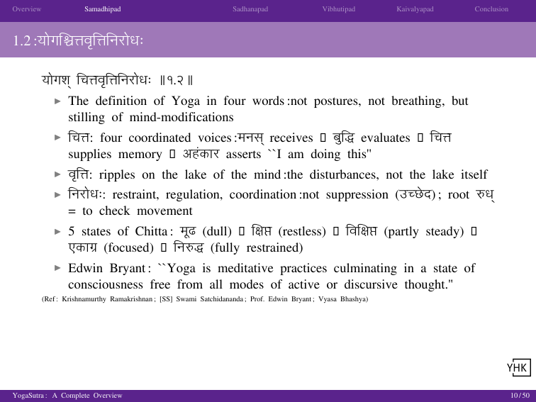

# Bharat Vidya (aka Indian Knowledge System)

**Study notes and slide decks on the Indian Knowledge Systems, led by a Yoga Sutra seminar series with Devanagari, transliteration and several translators side by side.**

What you will find here:
- **Yoga Sutra seminars:** a workshop and independent seminars with cheat sheets, built with XeTeX. Start with the Introduction deck, which opens with an Orientation drawn from a lecture on how the Sutra reached modern yoga. See [LaTeX/README.md](./LaTeX/README.md) for the file guide and build scripts.
- **[`YogaSutra/`](./YogaSutra/README.md):** reorganised study notes on the Yoga Sutra, the Devanagari text, hand-drawn mind maps of the four pada, a long list of video lectures and the [sources behind the slides](./YogaSutra/SOURCES.md), including the YogaSutraTrees knowledge graph by Giacomo De Luca.
- **[`YogaNidra/`](./YogaNidra/README.md):** Yoga Nidra notes, a detailed practice script and a [research reading list](./YogaNidra/Reading_list_research.md).
- **[`Yoga/`](./Yoga/README.md):** a curated list of Yoga resources and a meditation note.
- **[`Samskrit/`](./Samskrit/README.md):** curated lists on Sanskrit and the Arthashastra, and a reading list of [papers on Sanskrit and computing](./Samskrit/Reading_list_papers.md).

Books, recordings, course packs and coursework are not kept here; see [NOTICE.md](./NOTICE.md) and [MOVED_MATERIAL.md](./MOVED_MATERIAL.md). Content is under [CC BY-NC-SA 4.0](./LICENSE_CONTENT.md) and code under MIT. Corrections to the Sanskrit, transliteration or commentary are especially welcome; see [CONTRIBUTING.md](./CONTRIBUTING.md). To cite this work, use [CITATION.cff](./CITATION.cff). Progress of the current upgrade: [reports/STATUS.md](./reports/STATUS.md).

A sample slide from the YogaSutra Overview seminar, showing the Devanagari, transliteration, and multi-translator commentary format used throughout:

## Purpose
Under NEP (New Education Policy) 2020, IKS (Indian Knowledge System) is being recommended for even for Engineering streams.

This repository aims to explore and document the key aspects of the Indian Knowledge System, shedding light on its significance, evolution, and relevance in the modern world. By delving into its intricacies, we seek to promote a deeper understanding and appreciation of this invaluable heritage.

- Foster interdisciplinary research: IKS bridges the gap between ancient wisdom and modern challenges. By studying IKS, we can find innovative solutions to contemporary problems.
- Promote cultural heritage: Through this repository, we aim to celebrate India's rich intellectual legacy and encourage dialogue across disciplines.
- Empower learners: Whether you're a student, researcher, or enthusiast, IKS provides a platform to engage with traditional knowledge and contribute to its revival.

## Introduction
The Indian Knowledge System is a rich and diverse repository of ancient wisdom, encompassing various fields such as philosophy, science, medicine, mathematics, and more. Rooted in centuries-old traditions, it offers valuable insights into the cultural and intellectual heritage of India.

For a full map of what's in this repository, see [CONTENTS.md](./CONTENTS.md).

What is covered today:
- **Yoga**: a way of life. A curated list [here](./Yoga/README.md)
  - **Yoga Sutra**: notes, mind maps, sources and a Seminar System (`LaTeX/`): a Workshop and Seminars (Intro, Samadhipad, Sadhanapad, Vibhutipad, Kaivalyapad, Overview), each with a Beamer presentation and cheat sheet. Built via `make_yogasutra.bat`. More info [here](./LaTeX/README.md)
  - **Yoga Nidra**: notes, a detailed practice script, a seminar deck and a research reading list. More info [here](./YogaNidra/README.md)
- **Samskrit**: Predominant language in which this Vidya exists. A curated list [here](./Samskrit/Awesome_samskrit.md)
- **ArthaShastra**: Predominant text on geopolitics and governance. A curated list [here](./Samskrit/Awesome_arthashastra.md)

Other areas of the Indian Knowledge System (philosophy, science, Ayurveda, mathematics) are not covered yet.

## References
- [Indian Knowledge Systems (IKS) Division](https://iksindia.org/)  Division of Ministry of Education (MoE) located in the AICTE, New Delhi.
- [Introduction to Bharatiya Knowledge Systems (IKS) - Bori](https://bharatvidya.in/courses/enrolled/2460044)
- [Brhat | Bṛhat | बृहत्](https://www.brhat.in/) a culture engine to power creatives, research and design rooted in the Indian civilizational consciousness.
- [Course: IIT Gandhinagar 1st edition](https://www.youtube.com/playlist?list=PLRfu94TCePTtVPR-kC4RpIGIwo7-ViCGP)
- [Course: IIT Gandhinagar 2nd edition](https://www.youtube.com/playlist?list=PLRfu94TCePTtWtu0x145H_63WgoeYickE)
- [Course: IIT Gandhinagar 3rd edition](https://www.youtube.com/playlist?list=PLRfu94TCePTtLuEYSzmJXNYK_EnDSvY3N)
- [Course: IIT Gandhinagar 5th edition](https://www.youtube.com/playlist?list=PLRfu94TCePTu5cSVW9rWkX9-5vn5BDgpZ)
- [Course: IIT Gandhinagar 7th edition](https://www.youtube.com/playlist?list=PLRfu94TCePTt0JaPrZfTiQTNu9dlT-xiB)
- [Indian Knowledge System (IKS) : Concepts and Applications in Engineering](https://onlinecourses.swayam2.ac.in/imb24_mg20/preview) By Prof. B. Mahadevan, Dr. Vinayak Rajat Bhat, Dr. R Venkata Raghavan   |   Indian Institute of Management Bangalore (IIMB), Chanakya University, Bangalore
- [Indian Knowledge System (IKS) : Concepts and Applications in Science](https://onlinecourses.swayam2.ac.in/imb24_mg21/preview)
- [Indian Knowledge System (IKS) : Humanities and Social Sciences](https://onlinecourses.swayam2.ac.in/imb24_mg22/preview)
- [IKS FDP 2022 IITKgp CoEIKS](https://www.youtube.com/playlist?list=PLah-i6t8ZCQC76b9txCybHF9j_9l2kyrF)
- [Faculty Development Program 2021 in India’s Knowledge Systems (IKS)](https://www.youtube.com/watch?v=tip5_-Ep3gA) 9 hrs
- [IKS FDP on India's Knowledge Systems: Sources, Theories, Concepts and Practices (FDP_IKS:STCP 2021)](https://www.youtube.com/watch?v=TvMsKRP6FlQ)
- [AICTE Teaching Material](https://fdp-si.aicte-india.org/SIPTeachMaterialM8.php)
- [IITGN Readings](https://iks.iitgn.ac.in/readings_2016/)
- [Learn Sharada Lipi | Learn Sanskrit Online](https://www.youtube.com/playlist?list=PLmozlYyYE-ETiEDyzg3UYg4pbNz31nCEG)
- [National Seminar on Manuscripts](https://www.youtube.com/playlist?list=PLjFl99f9x7pvwoBi498eUvDVG4Fp5PIZu)
- [Dharohar](https://dharohar.org/en/the-cataloguing-process), [Sangrah](https://sangrah.org/), [Sanjaya Singhal](https://www.securemeters.com/in/council/sanjaya-singhal/)
- [Namami - National Mission for Manuscripts](https://www.namami.gov.in/)
- [Bori](https://bori.ac.in/), [Shrinand Bapat](https://bori.academia.edu/ShreenandBapat)
- [Prof Ravikiran](https://www.iiit.ac.in/people/faculty/ravi.kiran/) AI/ML for text detection IIITH [Intelligent Historical Document Image Analysis (IHDIA)](https://ihdia.iiit.ac.in/)
- [Sai Surasal](https://mitvedicsciences.edu.in/archives/team/dr-sai-ramakrishna-susarla), [VedVaapi](https://www.vedavaapi.org/), MIT-ADT Pune, Knowledge Graph, web platform, [Shastra Maps](https://mitvedicsciences.edu.in/shaastric-modeling-fdp)
- [Pawan Goyal IIT KGP](https://www.iitkgp.ac.in/department/CS/faculty/cs-pawang), [Sanskrit Heritage Site](https://sanskrit.inria.fr/)
- [Shaastra Maps: Enabling Conceptual Exploration of Indic Shaastra Texts](https://www.youtube.com/watch?v=S72Bj7EC--U)
- [Shaastric Modeling Course](https://mitvedicsciences.edu.in/enroll/shaastric-modeling)
- [National Youth Conference on Indian Knowledge Systems at Chinmaya Vishwa Vidyapeeth](https://www.youtube.com/playlist?list=PLbQHD8oHpmE066jXXY7rMSazzwlR4JepN)
- [वैदिक गणितम् - Vasant Patil](https://www.youtube.com/playlist?list=PLL7hynOJqNcTdQ1-P3sxut67hZFANxs4t)
- [Shaastra Setu Sanskrit Club IIT Roorkee](https://www.youtube.com/playlist?list=PLjFz5TMhii5rSF0DGqrD-atPq0wMn_O1k)
- [Battle For Sanskrit Infinity Foundation Official](https://www.youtube.com/playlist?list=PLGQElwzyJxty6OI0BeJf88mFbQtR1smoM)

## Contribution

We invite you to contribute to the development of this repository. See [CONTRIBUTING.md](./CONTRIBUTING.md) for ways to get involved and how to submit changes. Together, we can build a valuable resource that celebrates the richness of the Indian knowledge system!

## Disclaimer

This repository is a collaborative effort and may include diverse perspectives. The information provided here is not exhaustive, and users are encouraged to verify facts and seek additional sources for a comprehensive understanding. The maintainers of this repository are not responsible for the accuracy of individual contributions.