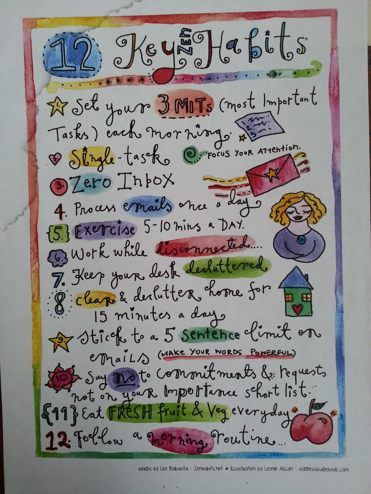
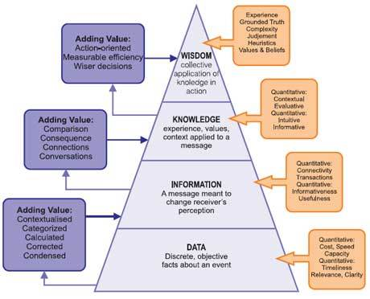

## Good life and the making of YogaNotes

The author's own notes on living well through the eight limbs of yoga, and how these notes themselves were made.

## Contents
- [Principles](GoodLife_Principles.docx): the principles in a Word document.
- [The eight limbs, as a mind map](GoodLife_Yoga8limbs.pdf), with the editable [FreeMind source](GoodLife_Yoga8limbs.mm).
- [The making of YogaNotes](The_making_of_YogaNotes.pdf): the author's write-up on the YogaNotes project.

## Pictures

*Image file: images/GoodLife_MostImportantThings.jpg*

*Image file: images/dikw-pyramid.jpg*

Back to the [Awesome Yoga list](../README.md).
