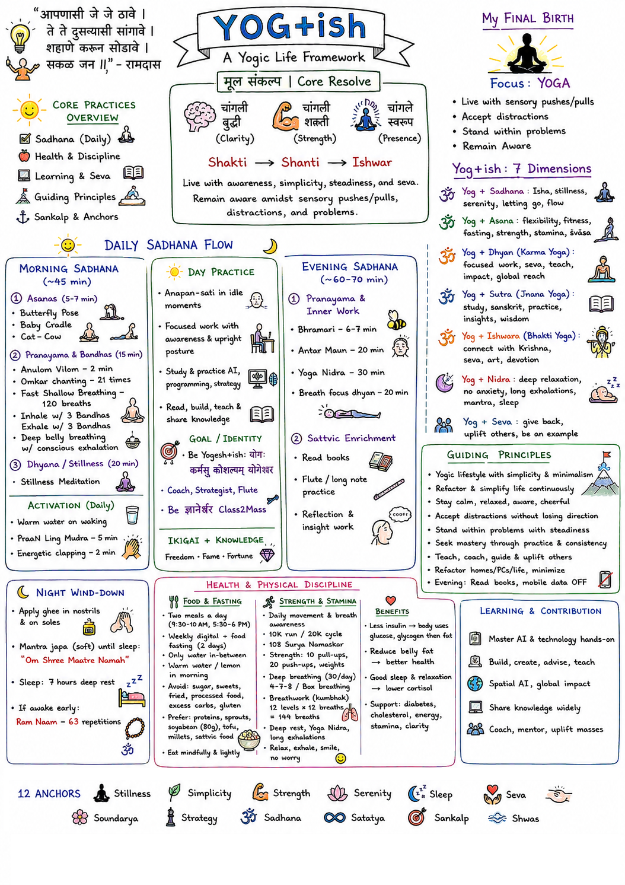
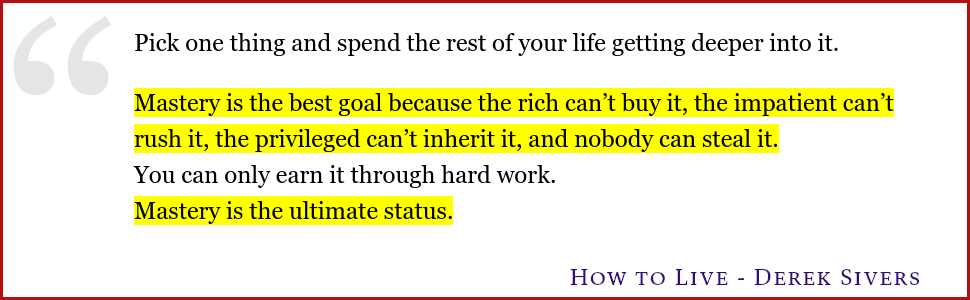

## Sketchnotes and diagrams

The author's own sketchnotes and one-page diagrams on practice and Indian philosophy (the Darshanas). Free to read and share
under the repository licence (see the root `README.md`).

## Contents
- [Sadhana](Sadhana.pdf): a sketchnote on practice (sadhana) and a framework for it.
- [Philosophies, Darshana](Philosophies_Darshana.pdf) and [Spirituality, Darshana](Spirituality_Darshana.pdf): one-page diagrams on the Darshanas.
- [Portraits](Portraits_Osho_Vivekananda.pdf): a portrait sheet.

## Pictures

*Image file: images/Sketchnotes_Sadhana_YogishFramework.png*

*Image file: images/Message_BeStrong_Vivekanand.jpg*

*Image file: images/Quote_Mastery_HowToLive_Sivers.png*

Back to the [Awesome Yoga list](../README.md).
